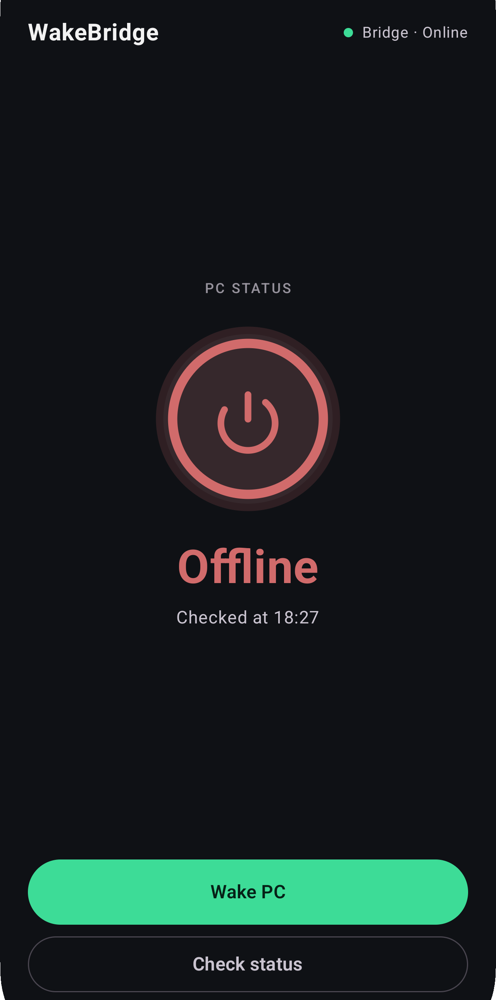
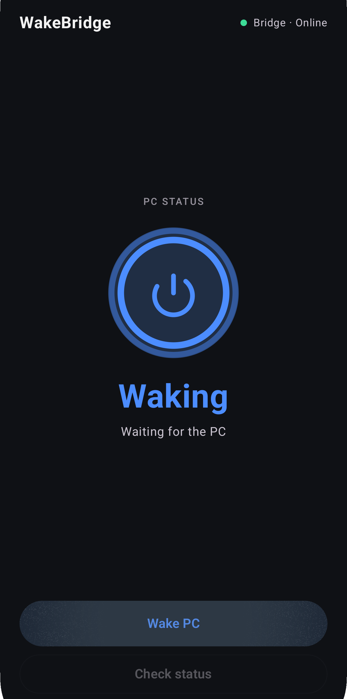
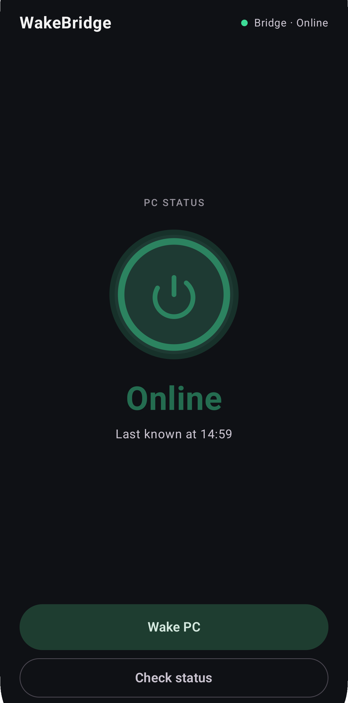
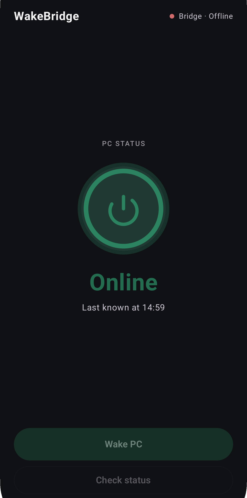
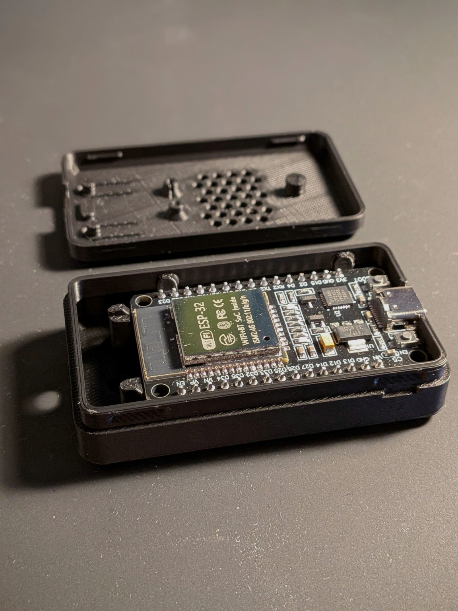
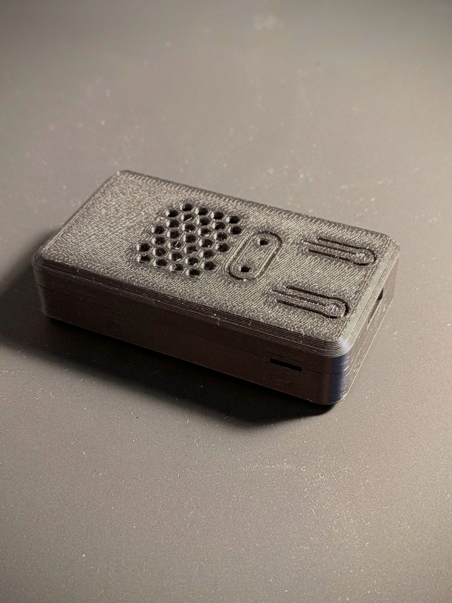
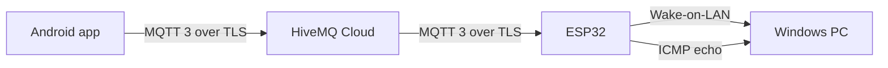

# WakeBridge

WakeBridge powers on a Windows PC from an Android phone. An ESP32 on the home LAN sends the Wake-on-LAN packet over wired Ethernet and checks the PC with ping. The phone and the ESP32 connect through MQTT over TLS, so the phone can be away from home.

The PC runs no WakeBridge software. The repository is the working system: a Kotlin and Jetpack Compose app, ESP32 firmware, and MQTT. The ESP32 is housed in a 3D-printed enclosure from an existing model.

## App preview

The home screen in each PC and bridge state. The bridge line stays separate from the power ring.

<table>
  <tr>
    <td align="center" width="25%">
      <br>
      <sub>Offline</sub>
    </td>
    <td align="center" width="25%">
      <br>
      <sub>Waking</sub>
    </td>
    <td align="center" width="25%">
      <br>
      <sub>Online</sub>
    </td>
    <td align="center" width="25%">
      <br>
      <sub>Bridge Offline</sub>
    </td>
  </tr>
</table>

## Hardware

The ESP32 is mounted in a 3D-printed enclosure so it can stay powered on the desk as a finished device. The model was not designed for WakeBridge. It is the existing [ESP32 DevKit V1 USB-C case](https://makerworld.com/sv/models/2189621-esp32-devkit-v1-usb-c-case#profileId-2377239) on MakerWorld.

<table>
  <tr>
    <td align="center" width="50%">
      <br>
      <sub>Board installed</sub>
    </td>
    <td align="center" width="50%">
      <br>
      <sub>Closed enclosure</sub>
    </td>
  </tr>
</table>

## The problem

A phone on another network cannot broadcast a Wake-on-LAN packet onto a home LAN. Opening that path usually means a VPN, a forwarded port, or an agent installed on the PC.

WakeBridge puts one always-on ESP32 on the LAN. The phone and the ESP32 both connect out to an MQTT broker over TLS. The PC stays a normal Wake-on-LAN target.

## Features

- Wake the PC from the phone.
- Check whether the PC answers a ping, on demand.
- Show the PC as Online, Offline, Unknown, or Waking.
- Show the ESP32 bridge as Online, Offline, or still Connecting.
- Keep the last PC reading, and label an older reading as last known rather than freshly checked.
- Disable Wake and Check while the bridge is not online.
- Publish ESP32 presence and the latest PC reading as retained MQTT messages.
- Verify the broker certificate on the phone and on the ESP32.

The home screen is one centered power stage: a power ring, the PC state, a short status line, a filled Wake PC button, and an outlined Check status button. The bridge state sits in the top corner, separate from the PC state.

## Architecture



The phone and the ESP32 use MQTT 3 with username and password on port 8883. The ESP32 is the only device that can see the PC. Wake-on-LAN and ping both stay on the local network.

## How it works

Waking the PC and learning that it is on are two different steps.

**Wake.** The app publishes `WAKE` to `wakebridge/desktop/command`. The ESP32 sends a Wake-on-LAN magic packet to `WOL_BROADCAST_IP` on UDP port 9, then publishes `wake_sent` on `wakebridge/desktop/status`. `wake_sent` means the ESP32 transmitted the packet. The PC is treated as available only after a later ping succeeds.

The app waits up to 5 seconds for `wake_sent`. It keeps the screen on Waking for up to 60 seconds. The ESP32 pings at the start of that window and then every 3 seconds.

**Power.** Each finished ping is published to `wakebridge/desktop/power` as `online|<unix>` or `offline|<unix>`. The timestamp comes from SNTP. The app treats a newer, plausible timestamp as the result of the current wake or check. A reading from the previous session does not clear Waking, and it does not complete a check that is still in progress.

If no fresh online reading arrives within 60 seconds, the app leaves Waking and reports that the PC did not come online.

**Check.** Check status publishes `CHECK` to `wakebridge/desktop/check`. The ESP32 sends one ping and publishes the same power message. The app waits up to 10 seconds. While a wake watch or another ping is already running, the firmware ignores a new check.

**Presence.** On connect, the ESP32 publishes retained `online` to `wakebridge/esp32/status`. Its MQTT last will is retained `offline` on the same topic, so a dead session still tells the phone the bridge is gone. Until that topic delivers a message, the app shows Connecting. A phone that has not reached the broker is not shown as a confirmed ESP32 outage.

Pings run only after Check, or during the short watch that follows Wake. The firmware does not poll the PC in the background.

A PC that does not answer ICMP is reported offline. A host firewall can drop ping from a machine that is actually up, so Offline means "no ping reply," not a guaranteed power reading.

## Tech stack

| Part | What it uses |
| --- | --- |
| Android | Kotlin 2.2, Jetpack Compose, Material 3, minSdk 26. App version 1.0. |
| MQTT on Android | HiveMQ MQTT Client 1.3, MQTT 3, TLS on port 8883 |
| Firmware | Arduino-ESP32 3.x, PubSubClient, `WiFiClientSecure` |
| PC reachability | ESP32 ICMP echo, one reply, 500 ms timeout |
| Time | SNTP via `pool.ntp.org`, UTC timestamps |
| Broker | HiveMQ Cloud, username and password |
| PC | Windows, Wake-on-LAN |

## Project layout

```text
android/WakeBridgeAndroid/     Android Studio project
esp32/wakeBridgeESP32/         Firmware sketch
docs/mqtt-migration.md         Planned broker move
docs/images/                   Screenshots and hardware photos
```

Local configuration stays out of git. `secrets.h` and `local.properties` are ignored. `secrets.example.h` contains placeholders only.

## Setup

### Android

1. Open `android/WakeBridgeAndroid` in Android Studio.
2. Add the broker settings to `android/WakeBridgeAndroid/local.properties`. Android Studio already uses that file for `sdk.dir`. Keep `sdk.dir` and add:

   ```properties
   MQTT_HOST=
   MQTT_USERNAME=
   MQTT_PASSWORD=
   ```

   `app/build.gradle.kts` reads those three keys from the Android project root. Port 8883 is fixed in the app. A separate MQTT user for the phone is recommended when the broker can restrict topics. WakeBridge does not create users or apply those restrictions.
3. Run the debug build on a phone with internet access.

The phone can be away from home. It only needs to reach the broker.

### ESP32

1. Install the ESP32 boards package and the PubSubClient library.
2. Copy `esp32/wakeBridgeESP32/secrets.example.h` to `secrets.h` in the same folder.
3. Set `WIFI_SSID`, `WIFI_PASSWORD`, `PC_MAC`, `PC_IP_1` through `PC_IP_4`, `MQTT_HOST`, `MQTT_PORT`, `MQTT_USERNAME`, and `MQTT_PASSWORD`. The example keeps `MQTT_PORT` at 8883, which is the port the Android app uses.
4. Set `WOL_BROADCAST_IP` in `wakeBridgeESP32.ino`. That define is not in `secrets.h`. It must be the broadcast address of the subnet that contains `PC_IP_1` through `PC_IP_4`. The packet goes to `WOL_PORT` 9.
5. Flash the sketch. After Wi-Fi connects, the serial log waits for NTP, then connects to MQTT.

Use a second MQTT user for the ESP32 when the broker can limit each user to the topics it publishes and subscribes to. The firmware stores whichever username and password are in `secrets.h`. It does not configure broker permissions.

`mqtt_ca.h` is the public TLS root. It is not a secret and does not belong in `secrets.h`.

### Wake-on-LAN on the PC

The PC and the ESP32 need to be on the same LAN. The PC is expected to use a wired Ethernet adapter, with Wake-on-LAN enabled for that adapter and in the system firmware. Wake-on-WLAN is not part of this project and has not been tested. No WakeBridge software runs on the PC.

## Security

Both clients use TLS on port 8883.

The Android client uses `sslWithDefaultConfig()`, so it trusts the platform certificate store and checks the broker name.

The ESP32 trusts the self-signed ISRG Root X1 certificate in `mqtt_ca.h` and checks the broker hostname. It starts SNTP after Wi-Fi connects and waits up to 15 seconds for a real clock before the first TLS handshake. Certificate dates cannot be checked against a clock that is still at the epoch. If NTP does not finish in time, the firmware logs that and retries later. It does not disable certificate checks.

Broker username and password live in `secrets.h` on the ESP32 and in `local.properties` for the Android build. Neither file is committed. The Android build copies the phone's username and password into `BuildConfig`, so they can be extracted from a compiled APK. Limit that broker user to the topics the phone publishes and subscribes to. That restriction is enforced by the broker, not by the app. The root in `mqtt_ca.h` is public.

Give the phone and the ESP32 separate broker users when the service can restrict publish and subscribe per user. That split is a broker setting, not something WakeBridge implements. The phone publishes `wakebridge/desktop/command` and `wakebridge/desktop/check`, and subscribes to `wakebridge/desktop/status`, `wakebridge/desktop/power`, and `wakebridge/esp32/status`. The ESP32 publishes and subscribes to the matching topics, including its retained last will on `wakebridge/esp32/status`.

MQTT is QoS 0. A command or a reading can be lost; the app's timeouts are what surface that. The broker account is the application login. The devices do not use a client certificate.

The phone accepts a power reading for the active request only when the timestamp is newer than the reading already on screen and sits close to the time of that request. Two checks in the same second can still look alike, because the payload has no separate request id.

## Status

The app, firmware, wake path, on-demand power check, and home screen are in use. The firmware in this repository verifies the broker certificate.

Still open before a wider public release:

- The MQTT broker move is planned and has not been started. See [MQTT migration](docs/mqtt-migration.md).
- One PC is configured at build time. There is no settings screen and no second target.
- The phone shows Connecting until `wakebridge/esp32/status` arrives. That line covers both "not connected yet" and "connected, still waiting for the ESP32."

## MQTT migration

**Status: planned. Not started.**

A replacement broker is under consideration and is not in use. The topic contract, retained messages, and certificate rules are written down in [docs/mqtt-migration.md](docs/mqtt-migration.md).
